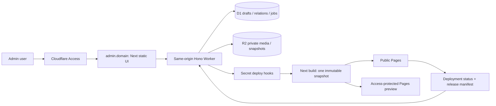

# Phase 1 — Audit Custom CMS

**06/11/2026 · Asia/Saigon.** Chỉ audit và thiết kế tại `D:\Profile\huy-portfolio`. Chưa triển khai Admin/API, cài dependency, chạy migration hoặc deploy Cloudflare.

## 1. Phương án để duyệt

Giữ public Next.js tại root hiện tại, static export lên Cloudflare Pages. Thêm `apps/admin` (Next App Router + TypeScript, static UI tiếng Việt), Hono Worker phục vụ bundle Admin và `/api/*` trên cùng host `admin.<domain>`. D1 lưu nội dung/quan hệ/lịch sử; R2 private lưu ảnh và snapshot. Worker tự xác thực Cloudflare Access JWT cho từng API.

Public build lấy **một snapshot bất biến**, không đọc draft/latest ở mỗi route. Preview là build riêng của chính frontend hiện có trên URL Pages preview được Access bảo vệ. Không cần VPS, Vite, React Router, full CMS hay đổi public sang SSR.

Giữ nguyên Growth Story **và** Services Scroll Stack theo yêu cầu gần nhất. Admin sửa content/assets; bố cục và GSAP configurations vẫn ở frontend code.

Ba quyết định cần duyệt:

1. Preview theo yêu cầu có độ trễ build; không phải live preview mỗi phím gõ.
2. Có thể lưu nhiều skills, nhưng chọn tối đa 5 vào Skill Lab hiện tại; Services giữ 3 thẻ/preset, Process giữ 4 bước trong bản đầu.
3. About hiện là artwork ghép sẵn. CMS thay cả artwork và sửa chữ HTML bên trái; chữ ký/caption trong ảnh không thể chỉnh độc lập. Tách chúng thành layer cần một thay đổi thị giác riêng, không nằm trong migration bảo toàn thiết kế.

## 2. Hiện trạng đã kiểm tra

| Hạng mục | Kết quả và nguồn |
|---|---|
| Phiên bản cài đặt | Lockfile: Next 16.4.3, React 19.3.1, GSAP 3.15.0, Lenis 1.3.27, TypeScript 5.9.3; `.node-version`: 24. Không nâng dependency trong audit. |
| Next config | `next.config.ts`: output export, trailingSlash, images unoptimized. |
| Routes | `/`, `/projects/`, `/projects/[slug]/`, not-found, icon; chưa có Admin/API/auth middleware. |
| Static generation | Detail có `generateStaticParams()` qua `getProjects()`, `dynamicParams=false`; 4 slug: toan-interior, lakeside-retreat, blue-voyage, form-living. |
| Data | `src/data/{projects,skills,achievements,site-settings,brands,services}.ts`: 4 concept projects, 5 skills, 14 platform/technology marks; marquee chọn 11; không có verified KPI. |
| Content layer | `src/lib/content.ts` trả local data; `getCopy/getBrand` đồng bộ; `getServices` ngoài interface repository. `Copy` suy ra từ object, chưa có runtime Zod. |
| Assets | `public`: 18 SVG, 11 JPG, 1 WebP, 1 TTF, 1 TXT và `_headers`; chưa media IDs/DB/upload. |
| SEO | Metadata chung và per-project; chưa sitemap, robots file, canonical, per-page OG image, structured data; chưa có domain thật trong config. |
| Cloudflare | README có hướng dẫn Pages, có `_headers`; chưa Wrangler/D1/R2/Access/deploy hook/API client. Chưa xác minh account hoặc production deployment. |
| Source control | Không thấy `.git` trong checkout audit; chưa có remote/CI/production branch để xác nhận. Cần backup và Git trước deployment tự động. |

Luồng chính: `src/data` → content layer → Server Components → props → Client Components/motion. **Ngoại lệ:** `Brand` là client gọi `getBrand()` qua content module. Không được thêm secrets/server fetch vào module rồi giữ nguyên client import; phải tách server adapter khỏi types và registry logo công khai.

Home: Hero → About → Skills → Technologies → Growth → Services → Featured → Marketing → Process → Contact.

### Motion cần bảo toàn

- `motion-provider.tsx`: một Lenis instance, GSAP ticker, ready/reduced/preloader state, route refresh và cleanup.
- `preloader.tsx`, `glass-scene.tsx`, `lib/motion/glass-*`: asset gating và hero entrance.
- `use-scene-motion.ts`: các selectors data-hero-line/reveal/parallax/scene/chart-line.
- `skill-lab.tsx`, `skill-entrance.ts`: hover/burst trên wrapper riêng; CSS chỉ có 5 vị trí.
- `featured-slider.tsx`: rank/3D/swipe/keyboard; có guard empty, key hiện là slug.
- `scroll-stacking-cards.tsx`, `service-stack.ts`: một sticky stage; thẻ 3 lên đủ và bỏ đệm trống cuối. CMS không chỉnh timing.
- `technology-marquee.tsx`: hai bản danh sách, bản thứ hai aria-hidden; registry logo còn local.

## 3. Những chỗ phải sửa khi tích hợp

| Phát hiện | Migration tối thiểu |
|---|---|
| `Project.status` là concept/published, không phải trạng thái CMS | Tách project_kind concept/delivered khỏi workflow và live publication. Concept vẫn được xuất bản với nhãn hiện tại. |
| Projects thiếu ID ổn định; key và liên kết dùng slug | UUID + slug unique + alias cho URL cũ; chuyển references/keys sang ID. |
| Hero/Growth dùng `projects[0]`; SkillLab dùng `skills[active]` | Section có project/media được chọn rõ; guard 0/1 items, active index hợp lệ, không modulo 0. |
| Ảnh suy tên `-800.jpg` trong Home/DeviceMockup/Slider/Showcase/Detail | MediaDTO chứa src/alt/dimensions/variants thật; helper srcset không `.replace()` extension. |
| Skill CSS chỉ skill-0…4 | CRUD lưu tùy số lượng; admin chọn tối đa 5 visible lab slots, 0 thì ẩn lab an toàn. |
| Heading chia dòng, chart marketing hiện 7 điểm | Form line fields/max length; ban đầu giữ 7 điểm và miền giá trị preset; không cho dữ liệu làm tràn khung. |
| About crop cố định từ mockup 1672×941 | Role `about-artwork`, preset crop/tỷ lệ; ảnh chân dung thường không thể thay trực tiếp cùng preset. Caption trong artwork không phải HTML editable. |
| Services 3 presets, reference projectSlug | FK project ID; giữ 3 thẻ; thêm main_media_id tùy chọn trong wrapper visual, không thay timeline. |
| CTA Hero/About và mailto Contact nằm trong JSX | Đưa href vào schema allowlist; giữ anchor/class/data selectors. |
| ProjectDetail luôn có laptop/gallery/tech; next project có thể trỏ chính nó | Type website/uiux/seo/content/ads, conditional blocks; website cũ giữ layout; SEO không bắt buộc screenshots; hide next nếu không có project khác. |
| Detail xoay ký hiệu công nghệ N/TS/≈/G | Dùng registry logos trong cùng DOM/kích thước. |
| Graph/service SVG paths và bars là minh họa code-native | Text/approved assets quản trị được; hình học/timing không phải campaign data hay trường code tùy ý. |
| Root tsconfig include **/*.ts(x) | Exclude apps/workers khỏi public build; tsconfig riêng; shared DTO browser-safe. |
| `.gitignore` bỏ toàn bộ `.env*` | Thêm ngoại lệ `.env.example`; ignore .dev.vars, .wrangler, local keys, generated snapshots. |

### Map Admin

Projects quản lý basic/type/client/date/body, media slots, stories, technologies, featured/slider overrides và SEO. Homepage có schema riêng cho Hero/About/Skills heading/Marquee/Growth/Services/Featured/Marketing/Process/Contact/Preloader text/UI labels; không page builder. Skills/Technologies dùng chung registry và marquee flags. Results tách evidence private khỏi source public. Settings chỉ identity/contact/socials/navigation/logo/favicon; không chứa deployment secrets.

## 4. Runtime và tổ chức repo



```text
src/                         public app giữ nguyên vị trí
public/                      giữ assets cũ
apps/admin/                  Next App Router, TS, static UI
workers/api/src/             routes/services/middleware/validators/repositories
workers/api/drizzle/          typed schema
workers/api/migrations/       SQL versioned, chỉ tạo từ Phase 2
packages/content/            DTO, snapshot compiler/adapter thuần
packages/schemas/            Zod, không secrets
scripts/cms/                 seed/build preparation/receipt/verification
```

Giữ npm + một lockfile, thêm workspaces/scripts có prefix. Root build vẫn là public. Không di chuyển `src/app` sang `apps/web`. Worker Static Assets binding `ASSETS` chứa Admin export; chạy Worker trước assets router để auth không bị SPA fallback bỏ qua. Hono + Zod + Drizzle D1 + jose là lựa chọn đề xuất; pin version và kiểm tương thích ở Phase 2. Không tạo Admin route trong public export.

### Auth và security

Access phủ toàn host Admin; Worker verify JWT từ Cf-Access-Jwt-Assertion bằng JWKS của issuer cố định, audience, signature, exp/nbf; sau đó kiểm `cms_users` active/role/subject. Không tin email header hoặc frontend guard. Owner được publish/rollback, editor chỉ draft nếu bổ sung sau. Không public registration hay password mặc định.

Mọi read draft, upload, media file, publish/restore đều bảo vệ. Write cần exact Origin + CSRF token gắn session + custom header; không wildcard credentialed CORS. API same-origin. Tắt workers.dev/preview host không cần; host còn mở vẫn verify. Body/upload limits, rate limit phù hợp, safe errors/request IDs, audit logs không secrets.

Local dùng test issuer/JWKS và key riêng nhưng cùng JWT verifier, chỉ local binding/loopback; production deploy guard từ chối local issuer/keys. Không có SKIP_AUTH ở production. E2E Access thật cần staging account.

Không dựa vào `ctx.access` cho Static Assets/Service Binding: [Workers Access](https://developers.cloudflare.com/workers/configuration/cloudflare-access/), [JWT validation](https://developers.cloudflare.com/cloudflare-one/access-controls/applications/http-apps/authorization-cookie/validating-json/).
## 5. Database và trạng thái

DDL cụ thể: **`docs/cms-schema-proposal.sql`** — tài liệu đề xuất, chưa áp dụng migration.

| Nhóm | Tables / quan hệ |
|---|---|
| Identity/media | cms_users; media_assets (R2 immutable key, hash, type, size, dimensions, alt, trạng thái) |
| Projects | projects; project_media; project_technologies; project_stories; project_slug_aliases |
| Expertise | skills; technologies; skill_technologies, unique lab slot 0–4 |
| Home | page_sections payload có schema version; section_media và section_projects với FK |
| Services | service_cards (3 slots/presets, FK media/project); service_card_logos |
| Results/config | achievements; site_settings singleton; seo_metadata cho home/listing/project |
| History | content_revisions; content_snapshots; snapshot_entities; snapshot_media |
| Publication/audit | publishing_jobs; publication_channels; publishing_events; audit_events |

Working entities dùng `workflow_status=draft|ready|archived`, version tăng mỗi save. **Ready không phải live**: published counts/badges dựa vào immutable snapshot đang được live pointer trỏ tới. Draft edit của project đang live không sửa bản người xem đang thấy. `project_kind=concept|delivered` độc lập; không biến concept thành dự án khách hàng khi seed.

Mutations dùng optimistic version/If-Match, prepared statements, validation và transaction/batch cho entity + relations + revision + audit. Reorder validate danh sách đầy đủ, không trùng, đúng version và cập nhật atomically. Slug collision được kiểm cả projects lẫn aliases, kể cả khác hoa/thường.

Snapshot capture phải nhất quán: batch đọc transactional hoặc content-generation compare-and-swap; nếu generation thay đổi trước commit thì retry. R2 và D1 không có distributed transaction: ghi object pending → commit manifest, lỗi có cleanup bù; không publish pointer đến object thiếu. Snapshot/revisions append-only, không endpoint sửa lịch sử. Revision payload giới hạn nhỏ; snapshot toàn website ở R2 private, D1 giữ checksum/references. [D1 batch](https://developers.cloudflare.com/d1/worker-api/d1-database/), [foreign keys](https://developers.cloudflare.com/d1/sql-api/foreign-keys/).

## 6. Media pipeline

- Upload qua authenticated Worker. Policy ban đầu 8 MiB/file + giới hạn dimensions/pixels; đây là policy ứng dụng, không phải quota Cloudflare. Kiểm MIME + magic bytes + dimensions, không chỉ extension.
- JPEG/PNG/WebP; AVIF chỉ bật sau khi validator/parser được kiểm chứng. Từ chối SVG upload trong bản đầu; SVG đã review trong repo vẫn dùng được. Logo mới có thể PNG/WebP.
- Server tạo UUID/hash object key; không dùng filename làm path. Quarantine đến khi validation xong; xóa object mồ côi khi DB commit thất bại. Credentials không ra browser.
- R2 private, không public r2.dev. Admin xem qua `/api/media/:id/file` có auth. Build agent chỉ đọc media của snapshot được cấp quyền. Evidence private không vào public manifest.
- Node build preparation tạo image variants bằng Sharp, cap decoding pixels, strip metadata; không giả định Sharp chạy trên Worker. Copy assets về `public/_cms/media/<hash>/...` trước Next build. Frontend người xem không phụ thuộc API/R2 lúc runtime.
- MediaDTO gồm ID/src/alt/width/height/variants/sizes/cropPreset. Artwork About giữ đúng composition và crop preset.
- Replace tạo media ID/object mới, không overwrite file của live release. Delete mặc định archive; chặn hard delete khi còn referenced trong working content, retained snapshot hay build/preview active; UI hiện nơi sử dụng và confirmation. GC sau retention. Giữ ảnh cũ để rollback.

Private R2 là lựa chọn để draft không bị lộ qua URL ảnh: [R2 bucket behavior](https://developers.cloudflare.com/r2/buckets/public-buckets/).

## 7. API contract

Tất cả `/api/*` là private. List có search/filter/sort allowlist, pagination default 25/max 100. Không endpoint public trả working drafts.

| Nhóm | Endpoint dự kiến |
|---|---|
| Identity/dashboard | GET /api/me, /api/dashboard, /api/csrf |
| Projects | GET/POST /api/projects; GET/PATCH/DELETE /:id; POST /:id/duplicate, /:id/archive, /:id/ready, /:id/unpublish; PUT /api/projects/order |
| Skills/technologies | CRUD + reorder, visible/lab slot/marquee flags |
| Home | GET /api/pages/home; GET/PUT /api/pages/home/:section; services CRUD theo preset |
| Media | GET /api/media; POST /upload; PATCH/DELETE /:id; POST /:id/replace; GET /:id/file và /:id/references |
| Results/config | CRUD /api/achievements; GET/PUT /api/settings; GET/PUT /api/seo/:key |
| History/preview | GET /api/revisions; POST /:id/restore; POST /api/preview; GET /api/preview/:jobId |
| Publish | POST /api/publish; GET /api/publish/status, /api/publish/:jobId; POST /api/publish/rollback |
| Build agent riêng | /internal/build/claim, /:jobId/snapshot, /:jobId/media/:id, /:jobId/receipt |

Response `{data, meta?, requestId}`; lỗi `{error:{code,message,fields?},requestId}`. 401/403/404/409/413/422/429 rõ nghĩa. Duplicate tạo ID/slug mới và draft, reuse media references. Unpublish/archive là pending publication, không xóa ngay nội dung live. URL allowlist http(s); mailto/tel chỉ ở CTA tương ứng; không arbitrary HTML/JS/CSS, không server fetch URL tùy ý.

## 8. Draft, Preview, Publish, Rollback

### Draft / Preview

Save → working row + revision; không cập nhật live pointer. Restore revision đưa nội dung về draft mới. Form editors có validation/cảnh báo references, không phải JSON editor chung hay page builder.

Preview dùng **Pages project riêng**, branch `cms-preview` khác production branch, build chính source public từ immutable draft snapshot. Mở URL deployment hash cụ thể sau build; không dùng generic form preview, không Next Draft Mode giả trong static export.

Bật Access cho preview deployments trước khi gửi draft. Không deploy draft lên production `project.pages.dev`/custom domain. Production branch của project preview chỉ có placeholder vô hại; script fail closed khi draft build sai branch/channel. Preview secrets chỉ ở preview environment. Kiểm unauthorized HTML, JS, images, static data và aliases; noindex không phải bảo mật.

Cloudflare Access toggle của Pages **chỉ bảo vệ preview deployments**, không tự bảo vệ production pages.dev/custom domains: [Pages preview deployments](https://developers.cloudflare.com/pages/configuration/preview-deployments/).

### Publish protocol

1. Owner gửi idempotency key + expected content generation. Validate toàn bộ content/references/media/evidence; lọc private fields.
2. Capture snapshot immutable (schema version, checksum, entity revisions, media IDs). D1 tạo job; unique active job mỗi channel ngăn chồng publication.
3. Worker gọi secret Deploy Hook. HTTP success chỉ là nhận trigger, chưa được báo live. Không giả định hook có thể truyền snapshot ID tùy ý vào build env.
4. Build agent dùng Access service credential scope riêng gọi claim active job, nhận jobId/snapshotId/checksum và download quyền hạn hẹp. Tất cả routes, metadata, media đọc cùng snapshot, không latest từng page.
5. Build preflight kiểm branch/channel/job. Tắt đường production auto-deploy ngoài coordinator; code release cũng dùng job với snapshot cố định. Agent receipts có job, nonce, commit, deployment URL/ID nếu có và checksum.
6. GenerateStaticParams sinh slug từ snapshot; tạo sitemap/robots/OG/redirects và public `release.json` chỉ có release ID/checksum. Build/route/assets tests trước artifact.
7. Scheduled reconciliation kiểm trạng thái Pages API và release manifest ở deployment URL **và main domain**. Đúng version + deployment success mới update live pointer/báo LIVE.
8. Build thất bại giữ previous live. Hook timeout/ambiguous giữ khóa để reconcile; không tự mở khóa rồi chạy job mới khi deployment cũ còn có thể hoàn tất. Retry có attempt identity; callback cũ bị từ chối.
9. Rollback tạo job mới từ snapshot retained, trải qua cùng kiểm chứng. Không sửa snapshot cũ, không coi hook accepted là rollback thành công.

[Deploy Hooks](https://developers.cloudflare.com/pages/configuration/deploy-hooks/) chỉ cung cấp trigger; CMS phải xây thêm version locking, correlation và verification. Production/preview build identities tách scope, không có quyền CRUD/publish. Cloudflare status token nằm ở Worker secret, quyền tối thiểu. Snapshot media đi kèm static artifact; preview artifact chứa draft nên toàn URL phải có Access.

## 9. Migration và danh sách file

Tách facade `src/lib/content.ts`, server-only IO `src/lib/content/server.ts`, browser-safe DTO trong `packages/content`. Brand nhận approved registry qua props/provider. Build script tải snapshot một lần vào generated file được ignore rồi compile thành shape tương thích Project/Skill/Copy/Settings/Services.

`CONTENT_SOURCE=local` tiếp tục dùng seed để dev. `CONTENT_SOURCE=cms` phải fail nếu snapshot thiếu/sai; không fallback seed rồi tuyên bố publish thành công. Cấp props trước mount để không chạy lại preloader hoặc nhân timeline.

| Phase | File tạo/sửa và gate |
|---|---|
| 1 — hiện tại | docs/cms-phase-1-audit.md + docs/cms-schema-proposal.sql. Chờ duyệt. |
| 2 | workers/api/{package.json,tsconfig,wrangler.jsonc,src/middleware,src/repositories,drizzle/schema.ts,migrations/0001_initial.sql}; packages/schemas, packages/content; root workspaces/tsconfig/gitignore; local env templates; tests/api. Gate: local DB/R2, JWT, constraints/migrations/seed. |
| 3 | apps/admin/src/app và components sidebar/table/form/toast/confirm; lib/api. Dashboard dữ liệu thật; loading/error/empty; Access integration. |
| 4 | Project/media routes/services, project editor/gallery/MediaPicker, scripts/cms/seed, content server adapter/media helper; chỉnh tối thiểu detail/showcase/slider/image props. Gate: CRUD, gallery, upload validation, 4 URL cũ + slug mới. |
| 5 | Section editors, skills/technologies/results/settings schemas/routes; props Home/Brand/SkillLab/ServiceVisuals/Contact. Gate: shared registry, all section content, 0/1/max items, giữ motion selectors/timing. |
| 6 | Publishing/snapshot/preview services + Admin status panel; scripts/cms/{prepare-build,receipt,verify-release}; sitemap.ts/robots.ts, metadata, generated redirects. Gate: draft isolation, deployment verified, rollback. |
| 7 | API integration/security, Admin browser/E2E, visual regression, backup restore và runbook. Production cutover sau staging + account configuration. |

Thứ tự module: seed parity → Projects/Media → Technologies/Skills → Homepage/Settings/Growth → Services → Results/SEO → Preview/Publish. Không chuyển tất cả dữ liệu cùng lúc. Existing website templates phải render như cũ; những thay đổi optional type/empty guard chỉ thêm khả năng tương thích.

## 10. Local và cấu hình cần cung cấp sau này

Lệnh **dự kiến, chưa có trong repo**: dev:admin, dev:api (Wrangler local), db:migrate:local, db:seed:local, test:api, build:admin, build:cms. Root dev/build public giữ được cách chạy cũ. Remote migrations/deploy tách riêng; backup trước schema change; seed idempotent với IDs ổn định, không truncate.

Phase 2 tạo `.env.example`, `apps/admin/.env.example`, `workers/api/.dev.vars.example`; giá trị thật ở ignored files hoặc Cloudflare secrets.

| Runtime | Config/binding | Secret |
|---|---|---|
| Worker | DB, MEDIA, ASSETS; environment; Access issuer/AUD; allowed origin; site URL | Hooks public/preview, Pages status token; local key chỉ local |
| Public build | CONTENT_SOURCE, CMS API origin, channel, expected branch, site URL | Access build-production credential, không NEXT_PUBLIC |
| Preview build | channel preview, allowed branch, deployment origin | Credential build-preview riêng, không mutation |
| Admin browser | same-origin /api, website URL | Không secret |

Cần cấu hình thủ công: account/zone/domain main+admin, Git remote/branches, D1/R2 IDs, Access applications/AUD/admin identity policy, 2 Pages projects/hooks, preview Access, build service identities, API scopes và staging. Chưa cần gửi credentials trong chat để duyệt Phase 1.

Ưu tiên Cloudflare tiers phù hợp, không thêm dịch vụ trả phí bên ngoài; chưa thể cam kết phí bằng 0 khi chưa biết usage/account quotas. Public static export được hỗ trợ; request-time cookies/Server Actions không chạy trong static public. [Cloudflare static Next.js](https://developers.cloudflare.com/pages/framework-guides/nextjs/deploy-a-static-nextjs-site/), [Next static export](https://nextjs.org/docs/app/guides/static-exports).

## 11. Kiểm chứng và acceptance

**Baseline lượt này:** 27/27 motion tests PASS; production build PASS với 6 content routes + not-found/icon; export 334 local references, redesign và services checks PASS. Build đầu gặp EPERM `.next/trace` từ cwd con; chạy lại từ workspace root với Set-Location thành công, không xóa output/dừng process. Chưa có backend để test auth/CRUD. Chưa kiểm browser trực quan hoặc Cloudflare deployment trong Phase 1.

Gates phải thực hiện khi implement:

- Auth: thiếu/giả/hết hạn/sai AUD JWT, user inactive/wrong role/origin/CSRF; không bypass trên alternate host hoặc assets route.
- DB: duplicate slugs/case, version conflicts, relational integrity, reorder atomic, empty content, seed idempotent, backup restore.
- Media: MIME/signature mismatch, size/pixel bomb, SVG/HTML/path traversal, unauthorized file GET, reference deletion, replacement giữ live version.
- Draft isolation: không draft/evidence/credentials trong public APIs/HTML/JS/images; private preview kiểm mọi route và asset, không chỉ homepage.
- Publication: concurrent publish/retry, hook ambiguous, failed build, stale callback, wrong checksum, restart, rollback; previous live vẫn hoạt động.
- Frontend: seed parity, 0/1/n projects, slug redirects, SEO không gallery, empty skills/max lab slots, ảnh mọi định dạng; new slug trong routes+sitemap.
- Browser/Admin: mobile layout, forms/media picker/toasts/errors/confirm; desktop/tablet/mobile GSAP, Skill burst, marquee, slider, Services full ascent/reverse/no blank tail, reduced-motion, keyboard.

Phase 1 chỉ thay **hai file tài liệu**. Không tạo CMS giả hoặc tuyên bố login/deploy đã hoạt động. Theo chỉ dẫn cuối prompt: **“START WITH PHASE 1 ONLY”** và **“Once the audit is reviewed and approved, proceed to Phase 2”**; chờ duyệt phương án trước backend foundation.